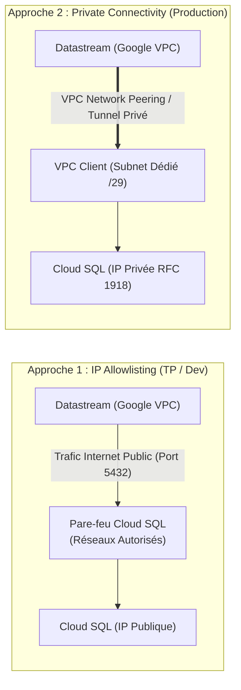

# 📘 Correction & Guide Approfondi : Activité 3 — Datastream CDC

> **Module :** Architecture Data Cloud sur Google Cloud Platform  
> **Niveau :** Master 2 Informatique / Cloud & Data Architecture  
> **Sujet :** Déploiement d'un pipeline de Change Data Capture (CDC) avec Cloud SQL, Datastream et BigQuery  

---

## 🧭 Sommaire

1. [Focus Réseau : Connexion Publique vs Connexion Privée (Private Connectivity)](#1-focus-réseau--connexion-publique-vs-connexion-privée)
2. [Focus Sécurité SQL : Le Triptyque des Permissions PostgreSQL](#2-focus-sécurité-sql--le-triptyque-des-permissions-postgresql)
3. [Focus Moteur : Décodage Logique, Publication et Replication Slot](#3-focus-moteur--décodage-logique-publication-et-replication-slot)
4. [Déroulé & Script SQL de Correction Intégrale](#4-déroulé--script-sql-de-correction-intégrale)
5. [Configuration du Stream & Stratégie FinOps de Fraîcheur](#5-configuration-du-stream--stratégie-finops-de-fraîcheur)
6. [Guide de Dépannage (Troubleshooting) des Pannes Fréquentes](#6-guide-de-dépannage-troubleshooting-des-pannes-fréquentes)

---

## 1. Focus Réseau : Connexion Publique vs Connexion Privée

L'une des étapes les plus critiques de l'intégration de Datastream concerne l'**exposition réseau de la base de données**. Deux approches existent sur Google Cloud :



---

### A. Méthode 1 : Liste d'IPs Autorisées (*IP Allowlisting*) — Approche du TP

* **Comment ça marche ?**
  L'instance Cloud SQL possède une IP publique. Datastream publie pour chaque région Google Cloud une liste d'adresses IP fixes (ex: 5 à 10 adresses pour `europe-west1`). On déclare ces IPs dans la section **Réseaux autorisés** (*Authorized Networks*) de Cloud SQL.
* **Avantages :** 
  * Très simple et rapide à mettre en place (pas besoin d'administrer des VPCs ou des sous-réseaux).
  * Idéal pour un prototype, un cours ou un environnement de développement temporaire.
* **Inconvénients majeurs en production :**
  * ❌ **Exposition sur Internet :** Le port `5432` de la base est accessible depuis l'extérieur (même filtré par IP).
  * ❌ **Maintenance des IPs :** Si Google fait évoluer les plages régionales de Datastream, le flux peut casser.
  * ❌ **Conformité & RGPD :** Les flux de données de production traversent l'Internet public (même s'ils sont chiffrés en TLS).

---

### B. Méthode 2 : Connexion Privée (*Private Connectivity Configuration*) — Standard de Production

En entreprise, les bases de données Cloud SQL de production **ne possèdent JAMAIS d'adresse IP publique**. Elles sont cantonnées à des adresses IP internes privées (RFC 1918, ex: `10.128.0.5`).

Pour que Datastream (service managé serverless de Google qui réside dans un réseau géré par Google) puisse joindre une base de données sur IP privée sans passer par Internet, on crée une **Configuration de connectivité privée** (*Private Connectivity Configuration*) :

#### ⚙️ Fonctionnement sous le capot :
1. **Création d'un Peering VPC :** Datastream établit un *VPC Network Peering* bilatéral direct entre le réseau interne de Datastream et votre propre Virtual Private Cloud (VPC).
2. **Allocation d'une plage d'IP dédiée :** Google demande de lui réserver un petit bloc d'adresses IP privées dans votre VPC (généralement un sous-réseau `/29`, soit 8 adresses IP, par exemple `10.0.100.0/29`).
3. **VMs mandataires managées :** Google provisionne automatiquement des proxys légers dans cette plage `/29` pour router le trafic de réplication directement vers l'IP privée de votre Cloud SQL.

#### 🛡️ Pourquoi c'est le standard industriel ?
* ✅ **Zero-Trust Network :** Aucun paquet ne sort sur Internet.
* ✅ **Invisibilité totale :** L'instance Cloud SQL n'a pas d'IP publique, rendant impossible tout scan de port externe ou attaque DDoS/brute-force.
* ✅ **Stabilité des performances :** Le trafic emprunte le backbone réseau ultra-rapide de Google avec une latence réseau minimale.

---

## 2. Focus Sécurité SQL : Le Triptyque des Permissions PostgreSQL

Pour que Datastream puisse répliquer les tables, il ne suffit pas de lui donner l'utilisateur `postgres` (ce qui violerait le principe de moindre privilège). On crée un utilisateur dédié `datastream_user`.

Cependant, sous PostgreSQL, la gestion des droits est **stricte et compartimentée**. L'exécution des 3 commandes suivantes est **indispensable** pour éviter les erreurs `permission denied` :

---

### 1. Droit de lecture sur les tables existantes
```sql
GRANT SELECT ON ALL TABLES IN SCHEMA public TO datastream_user;
```

* **Ce que fait cette commande :**  
  Elle parcourt le catalogue PostgreSQL à l'instant $T$ et accorde le privilège de lecture (`SELECT`) sur **toutes les tables existantes** du schéma `public` (ainsi que sur les vues et tables étrangères).
* **Pourquoi Datastream en a absolument besoin :**  
  Lors du lancement du flux, Datastream doit réaliser le **Backfill initial** (le snapshot complet initial des données existantes avant de streamer les deltas du journal WAL). Sans `SELECT`, Datastream ne peut pas lire le contenu initial des tables.
* **Sa limite majeure :**  
  Cette commande est un **instantané ponctuel** ! Elle n'affecte QUE les tables déjà présentes. Si une nouvelle table `reviews` est créée 5 minutes plus tard, `datastream_user` n'aura aucun droit dessus. C'est pourquoi la commande 3 est requise.
* **Sécurité :** Aucun droit d'écriture n'est octroyé (`INSERT`, `UPDATE`, `DELETE` sont interdits).

---

### 2. Le droit d'entrée dans le conteneur (Schéma)
```sql
GRANT USAGE ON SCHEMA public TO datastream_user;
```

* **L'analogie du dossier et des fichiers :**  
  Sous PostgreSQL, un **Schéma** fonctionne exactement comme un **dossier** dans un système d'exploitation, et les **Tables** sont les **fichiers** situés à l'intérieur.
* **Pourquoi cette commande est obligatoire :**  
  Même si vous accordez le droit de lire un fichier (`GRANT SELECT ON TABLE orders`), si l'utilisateur n'a pas le droit d'ouvrir le dossier qui le contient, le système lui bloque l'accès !
  $$\text{Sans } \texttt{USAGE sur le Schéma} \implies \textbf{"ERROR: permission denied for schema public"}$$
* **Que permet `USAGE` ?**  
  Il autorise l'utilisateur à "entrer" dans le schéma, à voir l'existence des objets et à les requêter par leur nom (`public.orders`).
* **Ce qu'il ne permet PAS :**  
  `USAGE` ne permet pas de créer de nouvelles tables dans le schéma (ce droit s'appelle `CREATE`). Datastream n'a pas besoin de créer des tables dans la base source, donc `USAGE` est suffisant et respecte le moindre privilège.

---

### 3. La règle automatique pour les tables futures
```sql
ALTER DEFAULT PRIVILEGES IN SCHEMA public
GRANT SELECT ON TABLES TO datastream_user;
```

* **La problématique métier :**  
  Une application en production évolue constamment. Lors du prochain sprint, un développeur va exécuter une migration :
  ```sql
  CREATE TABLE product_recommendations (...);
  ```
  Sans la commande `ALTER DEFAULT PRIVILEGES`, `datastream_user` n'aurait aucun droit sur cette nouvelle table. Le flux Datastream tomberait en erreur ou ignorerait silencieusement la table.
* **Ce que fait cette commande :**  
  Elle n'agit sur aucune table existante. Elle inscrit une **règle permanente dans le catalogue PostgreSQL** :
  > *« À chaque fois qu'une nouvelle table sera créée dans le schéma public, accorde automatiquement le privilège `SELECT` à l'utilisateur `datastream_user`. »*
* ⚠️ **Le piège subtil de PostgreSQL sur `DEFAULT PRIVILEGES` :**  
  Par défaut, `ALTER DEFAULT PRIVILEGES` ne s'applique qu'aux tables créées **par l'utilisateur qui exécute la commande**. Si vos migrations sont lancées par un utilisateur spécifique (ex: `fastmarket_app` ou `migration_bot`), il faut exécuter :
  ```sql
  ALTER DEFAULT PRIVILEGES FOR ROLE fastmarket_app IN SCHEMA public
  GRANT SELECT ON TABLES TO datastream_user;
  ```

---

## 3. Focus Moteur : Décodage Logique, Publication et Replication Slot

En plus des droits SQL traditionnels, la réplication CDC s'appuie sur le moteur interne de réplication logique de PostgreSQL :

```
[ Transactions applicatives ]
              │
              ▼
    [ Write-Ahead Log (WAL) ] ── (wal_level = logical)
              │
              ▼
   [ Publication : fastmarket-pub ]  (Définit QUOI répliquer)
              │
              ▼
   [ Slot Logique : fastmarket-rep ]  (Curseur LSN : garde en mémoire où en est Datastream)
              │
              ▼
      [ Google Datastream ] ──────► [ BigQuery ]
```

1. **`cloudsql.logical_decoding = on` :**
   * Oblige PostgreSQL à inscrire dans son journal WAL non seulement les octets modifiés sur disque, mais les métadonnées logiques compréhensibles (nom de table, colonnes, valeurs avant/après).
2. **L'attribut `WITH REPLICATION` :**
   * Autorise le compte `datastream_user` à ouvrir une connexion de streaming replication (protocole binaire de bas niveau pour consommer le flux WAL).
3. **La Publication (`fastmarket-pub`) :**
   * Groupe d'objets PostgreSQL émetteurs d'événements. `FOR ALL TABLES` garantit que toute insertion, modification ou suppression génère un événement logique.
4. **Le Slot de Réplication (`fastmarket-rep`) avec le plugin `pgoutput` :**
   * C'est un **pointeur d'avancement (LSN - Log Sequence Number)**. Tant que Datastream n'a pas confirmé à PostgreSQL la bonne réception d'une transaction, PostgreSQL **conserve le fichier WAL sur disque** pour éviter toute perte.

---

## 4. Déroulé & Script SQL de Correction Intégrale

Voici le script SQL complet et ordonné à exécuter sur la base de données PostgreSQL (via psql, DBeaver ou Cloud Shell) :

```sql
-- =============================================================================
-- SCRIPT DE CONFIGURATION POSTGRESQL POUR GOOGLE CLOUD DATASTREAM
-- =============================================================================

-- 1. Création de l'utilisateur dédié Datastream avec le rôle REPLICATION
CREATE USER datastream_user WITH REPLICATION ENCRYPTED PASSWORD 'VotreMotDePasseSecurise123!';

-- 2. Privilège super-utilisateur spécifique Cloud SQL (nécessaire pour gérer les slots)
GRANT cloudsqlsuperuser TO datastream_user;

-- 3. Accès au Schéma public (Le dossier)
GRANT USAGE ON SCHEMA public TO datastream_user;

-- 4. Accès en lecture aux tables actuelles pour le Backfill initial
GRANT SELECT ON ALL TABLES IN SCHEMA public TO datastream_user;

-- 5. Règle automatique pour accorder SELECT sur toutes les futures tables créées
ALTER DEFAULT PRIVILEGES IN SCHEMA public
GRANT SELECT ON TABLES TO datastream_user;

-- 6. Création de la Publication logique pour toutes les tables
CREATE PUBLICATION "fastmarket-pub" FOR ALL TABLES;

-- Transférer ou associer la propriété de la publication à datastream_user
ALTER PUBLICATION "fastmarket-pub" OWNER TO datastream_user;

-- 7. Création du Replication Slot logique utilisant pgoutput (moteur natif PG 10+)
SELECT PG_CREATE_LOGICAL_REPLICATION_SLOT('fastmarket-rep', 'pgoutput');

-- 8. Vérification des configurations créées
SELECT slot_name, plugin, active FROM pg_replication_slots;
SELECT pubname, puballtables FROM pg_publication;
```

---

## 5. Configuration du Stream & Stratégie FinOps de Fraîcheur

Dans l'Étape 3 du TP, deux paramètres méritent une attention particulière :

### A. Méthode d'écriture dans BigQuery
* **Mode par défaut (Merge / Cliché mis à jour) :** BigQuery conserve une table fidèle à l'état courant de PostgreSQL en appliquant automatiquement les `UPDATE` et `DELETE` sous le capot.
* **Mode Historique (Append-Only) :** Conserve chaque mutation sous forme d'une nouvelle ligne avec des métadonnées système (`_metadata_timestamp`, `_metadata_change_type`, `_metadata_deleted`). Très puissant pour la traçabilité et les analyses temporelles (*Audit Log*).

### B. Fraîcheur des données (*Max Data Freshness*) & Arbitrage FinOps
Dans Datastream, la fraîcheur des données peut être configurée de **0 seconde (continu)** à **24 heures** :

| Fraîcheur choisie | Comportement Datastream | Impact Coût BigQuery & Réseau | Cas d'usage adapté |
|---|---|:---:|---|
| **0 seconde (En continu)** | Stream en temps réel permanent | 💰 Coût élevé (micro-batches incessants, sollicitation CPU BigQuery) | Détection de fraude, alertes stocks critiques. |
| **5 minutes** | Regroupe les événements par micro-lots de 5 min | ⚖️ Bon compromis réactivité / coût | Dashboards de vente opérationnels. |
| **24 heures (Quotidien)** | Charge les modifications une fois par jour | 📉 Coût minimal (un seul batch optimisé) | Rapports financiers et comptables mensuels. |

> 💡 **Décision pour FastMarket :**  
> Si les analystes marketing n'ont besoin que d'une actualisation quotidienne, paramétrer la fraîcheur à **24h (ou 1h)** réduit considérablement les coûts de facturation BigQuery par rapport à un streaming en direct 24h/24 !

---

## 6. Guide de Dépannage (Troubleshooting) des Pannes Fréquentes

| Symptôme / Message d'erreur Datastream | Cause racine | Solution à appliquer |
|---|---|---|
| `Failed to read from the replication slot fastmarket-rep` | Le slot logique n'a pas été créé ou porte un autre nom. | Exécuter dans PostgreSQL : `SELECT PG_CREATE_LOGICAL_REPLICATION_SLOT('fastmarket-rep', 'pgoutput');` |
| `Failed to find the publication fastmarket-pub` | La publication est inexistante ou `datastream_user` n'en est pas propriétaire. | Exécuter : `CREATE PUBLICATION "fastmarket-pub" FOR ALL TABLES;` puis `ALTER PUBLICATION ... OWNER TO datastream_user;` |
| `Connection timed out` lors de la validation du profil source | Les IPs publiques de Datastream ne sont pas autorisées dans Cloud SQL. | Ajouter les IPs de Datastream dans **Cloud SQL > Modifier > Connexions > Réseaux autorisés** avec `/32`. |
| `Permission denied for table users` pendant le Backfill initial | L'utilisateur n'a pas reçu le droit `SELECT` sur les tables existantes. | Exécuter : `GRANT SELECT ON ALL TABLES IN SCHEMA public TO datastream_user;` |
| `Permission denied for schema public` | L'utilisateur n'a pas le droit de traverser le schéma. | Exécuter : `GRANT USAGE ON SCHEMA public TO datastream_user;` |
| `Logical decoding must be enabled` | Le flag Cloud SQL n'est pas activé ou l'instance n'a pas redémarré. | Activer `cloudsql.logical_decoding = on` dans les Flags Cloud SQL et s'assurer que `SHOW wal_level;` renvoie bien `logical`. |
